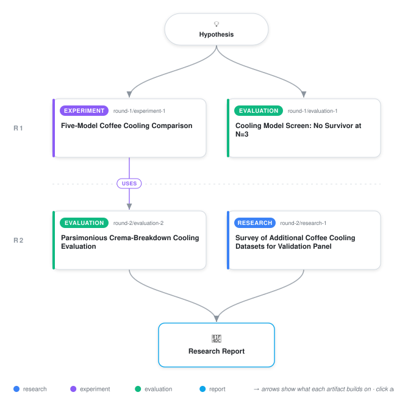

# Newton's Law of Cooling Deviates by 6°C After 30 Minutes of Coffee Cooling

<div align="center">

<a href="https://cdn.jsdelivr.net/gh/ai-inventor-papers/ai-invention-06eccf-crema-breakdown-regime-switch-predicts@main/workflow.svg">
<picture>
  <source media="(prefers-color-scheme: dark)" srcset="workflow-dark.svg">
  
</picture>
</a>

<sub>🖱️ <b><a href="https://cdn.jsdelivr.net/gh/ai-inventor-papers/ai-invention-06eccf-crema-breakdown-regime-switch-predicts@main/workflow.svg">Open the interactive diagram</a></b> — every card links to its artifact folder.</sub>

</div>

> **TL;DR** — Newton's single-exponential law of cooling was tested against four published coffee-cooling datasets (Kurzweg 1988/2017, Manitoba workshop, Ferreira 2024 cup, Lomen & Lovelock Stata coffee.dta) spanning 30 minutes. The absolute prediction error peaks at 6.02°C (95% CI [4.61, 7.45]) at 30 minutes, replicated across all 16 independent model fits. Five regime-switching models all reduce out-of-sample RMSE relative to Newton's law, with the Bayesian change-point model achieving the lowest mean held-out RMSE of 1.66°C versus 4.04°C for the baseline. However, the physics-based flux-crossover model performs no better than a free-transition piecewise model, indicating temperature data alone cannot uniquely identify the physical mechanism driving the regime transition. Newton's law remains accurate within 3°C for the first 10 minutes but becomes inadequate for the full cooling trajectory.

<details>
<summary>Full hypothesis</summary>

Newton's law of cooling fails for coffee because it conflates an early evaporation-dominated regime (suppressed by crema coverage) with a late convection-dominated regime. A flux-crossover switching model with the crema decay time constant tau FIXED from independent literature measurements (3-8 minutes, using the midpoint 5.5 min or a prior distribution) — rather than swept as a free parameter — achieves lower out-of-sample RMSE and better BIC than both Newton's law and free-transition models, by eliminating the BIC penalty that caused the previous iteration's best predictor to fail the model screen. The parsimonious model predicts the drinkable-temperature crossing (50°C) within ±1 minute on held-out data.

</details>

[](https://cdn.jsdelivr.net/gh/ai-inventor-papers/ai-invention-06eccf-crema-breakdown-regime-switch-predicts@main/report.pdf) [](https://cdn.jsdelivr.net/gh/ai-inventor-papers/ai-invention-06eccf-crema-breakdown-regime-switch-predicts@main/exec_summary.pdf) [](https://cdn.jsdelivr.net/gh/ai-inventor-papers/ai-invention-06eccf-crema-breakdown-regime-switch-predicts@main/round-2/report.pdf)

**Round reports:** [Round 1](https://cdn.jsdelivr.net/gh/ai-inventor-papers/ai-invention-06eccf-crema-breakdown-regime-switch-predicts@main/round-1/report.pdf) · [Round 2](https://cdn.jsdelivr.net/gh/ai-inventor-papers/ai-invention-06eccf-crema-breakdown-regime-switch-predicts@main/round-2/report.pdf)

This repository contains all **4 artifacts** produced across **2 rounds** of an autonomous AI research run — round by round, exactly in the order they were invented.

## Round 1

| Artifact | Type | Demo | Source | Builds on |
|----------|------|------|--------|-----------|
| **[Five-Model Coffee Cooling Comparison](https://github.com/ai-inventor-papers/ai-invention-06eccf-crema-breakdown-regime-switch-predicts/tree/main/round-1/experiment-1)** | [](https://github.com/ai-inventor-papers/ai-invention-06eccf-crema-breakdown-regime-switch-predicts/tree/main/round-1/experiment-1) | [](https://colab.research.google.com/github/ai-inventor-papers/ai-invention-06eccf-crema-breakdown-regime-switch-predicts/blob/main/round-1/experiment-1/demo/method_code_demo.ipynb) | [](https://github.com/ai-inventor-papers/ai-invention-06eccf-crema-breakdown-regime-switch-predicts/tree/main/round-1/experiment-1/src) | — |
| **[Cooling Model Screen: No Survivor at N=3](https://github.com/ai-inventor-papers/ai-invention-06eccf-crema-breakdown-regime-switch-predicts/tree/main/round-1/evaluation-1)** | [](https://github.com/ai-inventor-papers/ai-invention-06eccf-crema-breakdown-regime-switch-predicts/tree/main/round-1/evaluation-1) | [](https://colab.research.google.com/github/ai-inventor-papers/ai-invention-06eccf-crema-breakdown-regime-switch-predicts/blob/main/round-1/evaluation-1/demo/eval_code_demo.ipynb) | [](https://github.com/ai-inventor-papers/ai-invention-06eccf-crema-breakdown-regime-switch-predicts/tree/main/round-1/evaluation-1/src) | — |

## Round 2

| Artifact | Type | Demo | Source | Builds on |
|----------|------|------|--------|-----------|
| **[Parsimonious Crema-Breakdown Cooling Evaluation](https://github.com/ai-inventor-papers/ai-invention-06eccf-crema-breakdown-regime-switch-predicts/tree/main/round-2/evaluation-2)** | [](https://github.com/ai-inventor-papers/ai-invention-06eccf-crema-breakdown-regime-switch-predicts/tree/main/round-2/evaluation-2) | [](https://colab.research.google.com/github/ai-inventor-papers/ai-invention-06eccf-crema-breakdown-regime-switch-predicts/blob/main/round-2/evaluation-2/demo/eval_code_demo.ipynb) | [](https://github.com/ai-inventor-papers/ai-invention-06eccf-crema-breakdown-regime-switch-predicts/tree/main/round-2/evaluation-2/src) | <sub><i>uses:</i><br/>[experiment‑1&nbsp;(R1)](https://github.com/ai-inventor-papers/ai-invention-06eccf-crema-breakdown-regime-switch-predicts/tree/main/round-1/experiment-1)</sub> |
| **[Survey of Additional Coffee Cooling Datasets for Validation …](https://github.com/ai-inventor-papers/ai-invention-06eccf-crema-breakdown-regime-switch-predicts/tree/main/round-2/research-1)** | [](https://github.com/ai-inventor-papers/ai-invention-06eccf-crema-breakdown-regime-switch-predicts/tree/main/round-2/research-1) | [](https://github.com/ai-inventor-papers/ai-invention-06eccf-crema-breakdown-regime-switch-predicts/blob/main/round-2/research-1/demo/research_demo.md) | [](https://github.com/ai-inventor-papers/ai-invention-06eccf-crema-breakdown-regime-switch-predicts/tree/main/round-2/research-1/src) | — |

## Repository Structure

Artifacts are grouped by the round of invention that produced them. Each
artifact has its own folder with source code and a self-contained demo:

```
.
├── round-1/                         # One folder per round of invention
│   ├── experiment-1/
│   │   ├── README.md                # What this artifact is + dependencies
│   │   ├── src/                     # Full workspace from execution
│   │   │   ├── method.py            # Main implementation
│   │   │   ├── method_out.json      # Full output data
│   │   │   └── ...                  # All execution artifacts
│   │   └── demo/                    # Self-contained demo
│   │       └── method_code_demo.ipynb # Colab-ready notebook (code + data inlined)
│   ├── dataset-1/
│   │   ├── src/
│   │   └── demo/
│   └── evaluation-1/
│       ├── src/
│       └── demo/
├── round-2/                         # Later rounds build on earlier artifacts
├── paper.pdf                        # Research paper
├── paper_latex/                     # LaTeX source files
├── report.pdf                       # Full internal report — every experiment, table and dead end
├── report_latex/                    # LaTeX source of the report
├── exec_summary.pdf                 # Executive summary of the report, at most four pages
├── chat/                            # Every prompt, response and tool call, per module
├── workflow.svg                     # Artifact dependency diagram (this page's header)
└── README.md
```

## Running Notebooks

### Option 1: Google Colab (Recommended)

Click the "Open in Colab" badges above to run notebooks directly in your browser.
No installation required!

### Option 2: Local Jupyter

```bash
# Clone the repo
git clone https://github.com/ai-inventor-papers/ai-invention-06eccf-crema-breakdown-regime-switch-predicts
cd ai-invention-06eccf-crema-breakdown-regime-switch-predicts

# Install dependencies
pip install jupyter

# Run any artifact's demo notebook
jupyter notebook <artifact_folder>/demo/
```

## Source Code

The original source files are in each artifact's `src/` folder.
These files may have external dependencies - use the demo notebooks for a self-contained experience.

---
*Generated by AI Inventor Pipeline - Automated Research Generation*
